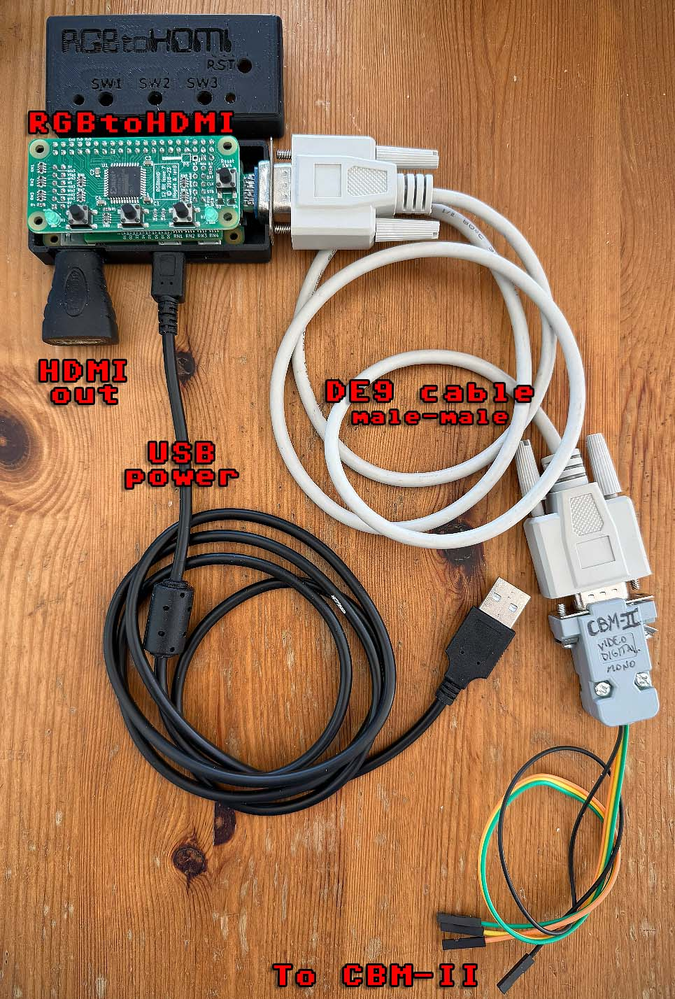
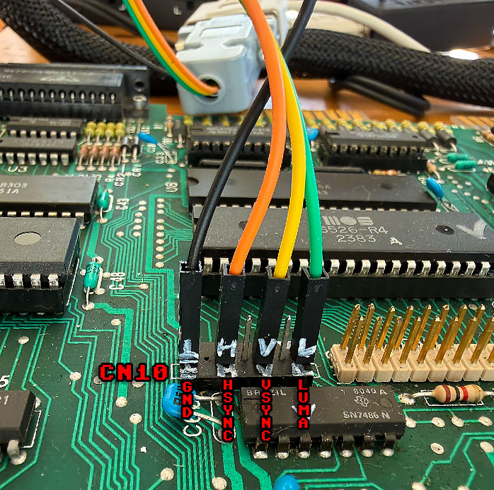
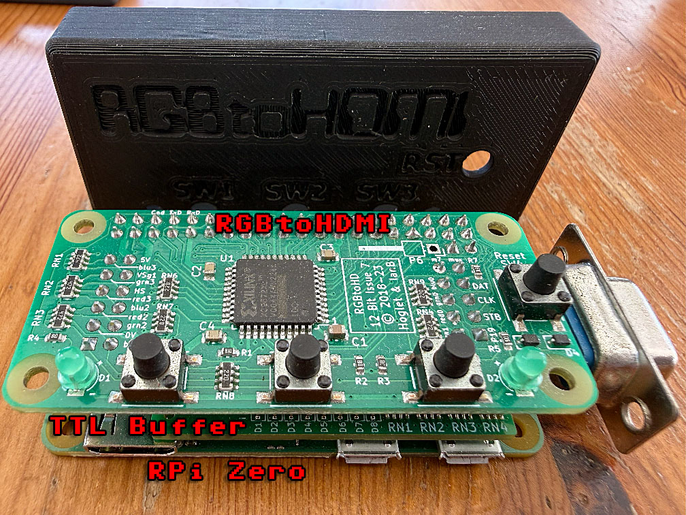

# CBM-II Video Output to HDMI

How to use a HDMI display with your CBM-II machine.  
Tested on B-Series (B128/B256 a.k.a. CBM 600/700).  

**NOTE**: The P500 model uses a different video chip (VIC-II) and a different connector. Do **NOT** use this guide for a P500.  

  
*The final solution (High-Profile machines)*

## Ingredients

| **Quantity** | **Item** | **Notes** |
|---:|---|---|
| 1 | [RGBtoHDMI](https://github.com/hoglet67/RGBtoHDMI/wiki) | Including RPi Zero, MicroSD card, and USB cable (power) |
| 1 | [RGBtoHDMI TTL Buffer Board](https://github.com/hoglet67/RGBtoHDMI/wiki/Bill-of-Materials-%28TTL-Buffer-Boards%29) | Get the "EGA/CGA/MDA" one with DE9 female port |
| 1 | DE-9 female to DE-9 female cable | This allows also Commodore 128 VDC compatibility |
| 1 | DE-9 male solder-cup connector ||
| 4 | Wires¹ | 4 female to male (or female) jumper wires |
| 1 (6xx models) | 5-pin DIN male 180° solder-cup connector | **Only on Low-Profile (6xx) machines**|
| 1 (optional) | RGBtoHDMI plastic case ||
| 1 (if needed) | Mini-HDMI (Type C) male to HDMI (Type A) female adapter ||

¹ I recommend using 4 different wire colors to avoid mistakes.

## Video connector pinout

High-Profile and Low-profile machines have different connectors.  
Pick the right one.  

### High-Profile (7xx models) pinout

The video connector on the motherboard is identified as CN10.  
These machines output 14 lines per character.  

  
*Motherboard connections (High-Profile machines)*

| **Pin** | **Signal** | **Wire color in photos**|
|---:|---|---|
| 1 | Video (Luma) |Green|
| 2 | GND ||
| 3 | V-Sync |Yellow|
| 4 | GND ||
| 5 | H-Sync |Orange|
| 6 | [key/missing] ||
| 7 | GND |Black|

### Low-Profile (6xx models) pinout

**NOTE: I do not have a Low-Profile machine, so everything in this chapter is untested, and I have no photos.**

The video connector on the motherboard is identified as J3, a 5-pin DIN female socket mounted on the motherboard.  
These machines output 8 lines per character.  

| **Pin** | **Signal** |**Wire color**|
|---:|---|---|
| 1 | Video (Luma) |Green|
| 2 | GND |Black|
| 3 | V-Sync |Yellow|
| 4 | Composite ||
| 5 | H-Sync |Orange|

**NOTE: You will need to wire the DE9 signals to a 5-pin DIN male connector which will plug into the back side of your Low-Profile machine.**

## The RGBtoHDMI

This is an [open source project](https://github.com/hoglet67/RGBtoHDMI/wiki) using a Raspberry Pi Zero to provide pixel-perfect rescaled video output for several different vintage machines.  
I use it in conjunction with its optional [TTL Buffer Board](https://github.com/hoglet67/RGBtoHDMI/wiki/Bill-of-Materials-%28TTL-Buffer-Boards%29) which provides electrical protection and a DE9 female interface connector for RGBI digital input and can be easily adapted to support different vintage machines such as IBM PC with CGA/EGA/MDA, Commodore 128 VDC (80-column chip) and others.  
You can build everything yourself, or buy it (and the TTL board) already made from different resellers.  

Keep in mind you may have to provide your own Pi Zero, and Micro SD card.
I also recommend getting or 3D-printing a case for it.

  
*The RGBtoHDMI three board sandwich*

We'll use a **DE-9 male to DE-9 male cable** (often incorrectly called "DB-9" instead of "DE-9").  
One end of this cable connects directly to the RGBtoHDMI TTL board, and the other end can be connected directly to other vintage machines.  
In our case, the other end will need an adapter (see next chapter).  

## DE9 to B128/B256 adapter

### High-Profile (7xx models) adapter

Wire one end of each of the 4 jumper wires to the DE-9 male solder-cup connector.  
This is the DE-9 pinout:

| **Pin** | **Signal** | **Description** |**Wire color in photos**|
|---:|---|---|---|
| 1 | GND | Ground |Black|
| 4 | G | Video (Luma) |Green|
| 8 | H-Sync | Horizontal sync — TTL |Orange|
| 9 | V-Sync| Vertical sync — TTL |Yellow|

### Low-Profile (6xx models) adapter

Same as for High-Profile, but you'll need to cut the female jumper ends of the wires and solder them to a 5-pin DIN male 180° solder-cup connector that can plug into the external DIN socket on the back of the machine.  
See [Low-Profile (6xx models)](#low-profile-6xx-models-pinout).  

**NOTE:** I don't have a Low-Profile machine, so no pictures are provided.  

## RGBtoHDMI Settings

### High-Profile (7xx models)
The current RGBtoHDMI firmware does not include a video profile for CBM-II High-Profile machines.
[TBD]

### Low-Profile (6xx models)
Low-Profile machines should be already supported (try with IBM CGA or Commodore 128).

## Embedding SID audio

The RGBtoHDMI supports an optional audio board.  
I prefer to use an external HDMI audio embedder.  

## Power on

After you have double checked everything and made sure there are no shorts, you can power on.  
It may take several seconds to see a boot prompt on screen (especially on the B256).  

## Troubleshooting

If voltages are ok, and your board has a MOS 6545A video chip, chances are this chip has failed. You can replace it directly with a Motorola 68B45P.
Other chips prone to failures are: PLA (if you have a MOS one) and the 6509 CPU.

# LICENSE

Creative Commons, CC BY

https://creativecommons.org/licenses/by/4.0/deed.en

Please add a link to this github project.
