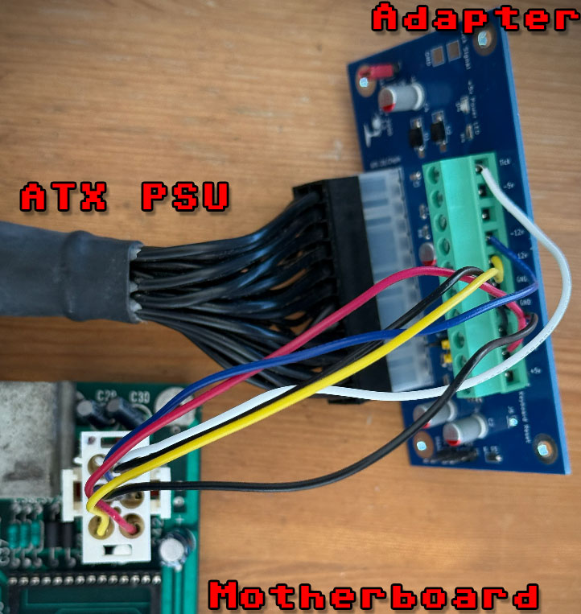
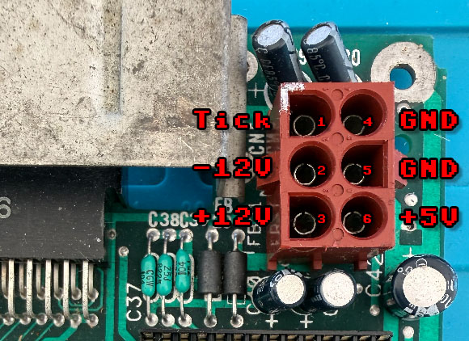
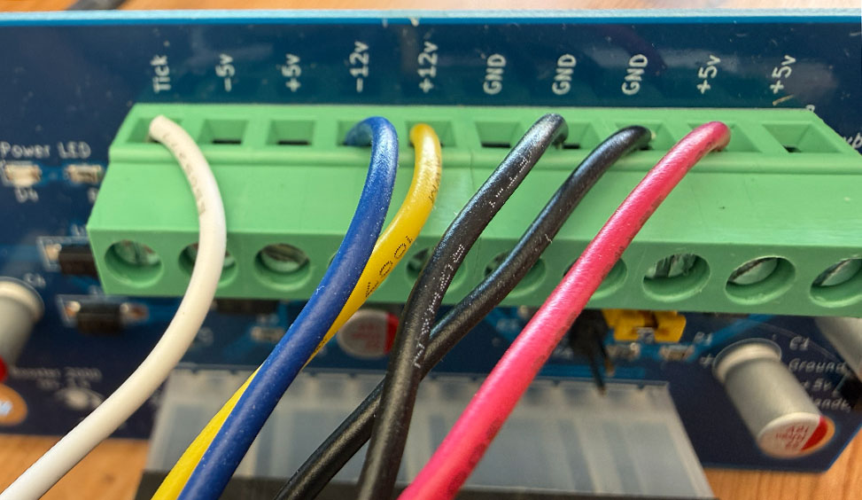
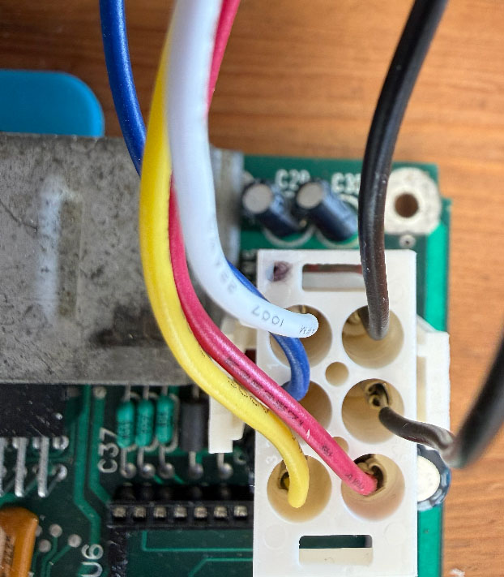

# CBM-II Replacement PSU

Tested on B-Series (B128/B256 a.k.a. CBM 600/700).  

**IMPORTANT NOTE**: I am not sure about the P500 (a.k.a. CBM 500) pinout. Check pinout and voltages before trying.  

## Ingredients

| **Quantity** | **Item** | **Notes** |
|---:|---|---|
| 1 | ATX PSU | Minimum ratings: +5V 6.5A, +12V 0.4A, -12V 0.3A   |
| 1 | Amiga 2000 / 3000 ATX Power Adapter PCB | I got the one from _LeapMaker_ on eBay. IMPORTANT: Get the model **with Tick** |
| 1 | TE 350715-1 AMP 6-pin plug housing | |
| 6 | TE 350547-1 AMP pin contacts | 20–14 AWG spare pins¹ |
| 6 | Wires | 20 AWG, stranded (though I used solid-core without issues) |

¹ You also need a crimping tool (I used Haisstronica HS-5327). Buy more pins in case you are not familiar with crimping.  

## PSU connector pinout

The female PSU connector on the motherboard is brown, identified as CN5 on Hi-Profile boards, or J5 on the Lo-Profile boards.  
**IMPORTANT NOTE**: I am not sure about the P500 model. May be same or different. Check it first !

| **Pin** | **Signal** | **Color in photos**|
|---:|---|---|
| 1 | 50/60 Hz Tick input |White|
| 2 | −12 V DC |Blue|
| 3 | +12 V DC |Yellow|
| 4 | GND |Black|
| 5 | GND |Black|
| 6 | +5 V DC |Red|

## PSU adapter board

I used the _Amiga 2000 / 3000 ATX adapter_ PCB from seller _LeapMaker_ on eBay.  
It comes with or without Tick generator. Get the model **with Tick** unless you have a different way to generate the Tick signal on PSU connector pin 1.  

The connection is straightforward. The outputs from the screw terminal block (in green) are clearly indicated on the PCB.  
You only need to connect Tick, -12V, +12V, ground (GND), and +5V. There should be no need to connect two GND wires, but I did it anyway.  

## Crimping the wires

The male PSU plug is a 2×3 TE/AMP Universal MATE-N-LOK plug (i.e. the white one in the image below).  
The plastic plug comes with no pins. Do **NOT** insert the pins in the plug before crimping.  
First, crimp all the wires to the metal pins.  
You may want to buy more than 6 pins if you never crimped this kind of pins before.  There are several tutorial videos on the Internet.  
Make sure all pins are correctly and firmly crimped to their wires.  
**IMPORTANT: Make sure the plug is oriented correctly. It is not symmetric. Pin 1 is "D" shaped, not "O" shaped !!!**  
After verifying the correct orientation of the plug, then insert the crimped pins.  
Make sure you insert the pins in the correct positions.  
**WARNING**: Inserting pins in the wrong position may damage your motherboard.  

## Double check connections

Keep your system powered off.  
Plug the PSU connector into the motherboard.  
Get your meter and set it to verify continuity.  
Make sure no voltage line is shorted to ground.  
Make sure no voltage line is shorted to another voltage line.  
The two ground (GND) pins go to the common ground (that is normal).  
Then double check again all connections both on the ATX adapter and on the motherboard.

## Power on

After you have double checked everything and made sure there are no shorts, you can power on.  
It may take several seconds to see a boot prompt on screen (especially on the B256).  

## Troubleshooting

If you get no video signal, check voltages on the SID chip: pin 25 should be +5V and pin 28 should be +12V.  
If voltages are ok, and your board has a MOS 6545A video chip, chances are this chip has failed.  
Other chips prone to failures are: PLA (if you have a MOS one) and the 6509 CPU.  

