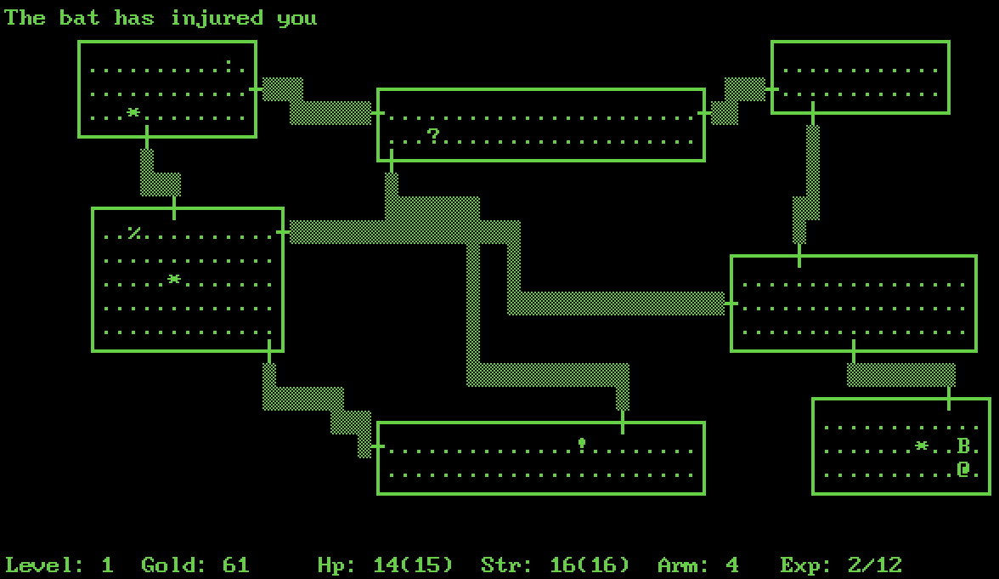

# Rogue for CBM-II

Ported from Classic Rogue 5.4.4: https://github.com/Davidslv/rogue.

## Requirements

- A Commodore B128 or B256 (CBM-II series 600 and 700).
- A disk drive or USBKAV device [work in progress].

## Release files

Binaries are [here](release/)

## Optional (recommended)

- If you are using the old character ROM (901232-01), you may want to upgrade to the new one ([901232-02](https://www.zimmers.net/anonftp/pub/cbm/firmware/computers/b/characters.901232-02.bin))
 for much better PETSCII rendering.
- If using the VICE xcbm2 emulator, go to "Settings" → "Machine" → "ROM" → "Chargen", and then change it to use the 901232-02 ROM file.

## Build details

- Classic Rogue 5.4.4 source code is patched to compile on [Oscar64](https://github.com/drmortalwombat/oscar64) targeting PET32.  
- Code and some data stay (barely !) in bank 1, while most strings and other structs are moved to bank 2.  
- I/O routines are replaced with CBM-II versions.
- Huge PETSCII "Graphics" upgrade ;-) ... Make sure you have the latest [901232-02](https://www.zimmers.net/anonftp/pub/cbm/firmware/computers/b/characters.901232-02.bin) Char ROM.

# LICENSE

This project is licensed under a BSD-style license. See [LICENSE.TXT](release/LICENSE.TXT) for details.

Copyright (C) 1980-1983, 1985, 1999 Michael Toy, Ken Arnold and Glenn Wichman

Portions based on work by:

Nicholas J. Kisseberth (state.c, mdport.c)
David Burren (xcrypt.c)

This is a port from:
https://github.com/Davidslv/rogue

Please add a link to this github project.
