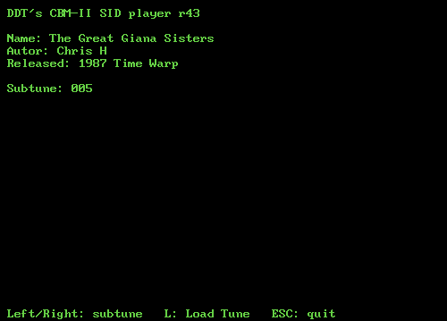

# CBM-II (B128/B256) SID player

Play C64 SID tunes on your CBM-II computer.  
Currently supports B128/B256 only.  

## F.A.Q.

**Q.** Are tunes playing samples supported ?  
**A.** Some ways of playing samples are supported (e.g. _Giana Sisters_).

**Q.** My modern SID replacement is not working.  
**A.** Make sure it supports 2 MHz operation, and you have installed the latest firmware upgrade.  

**Q.** Some tunes are not played correctly.  
**A.** SID tunes are made to run on a C64 on a 1 MHz chip.  The C64 hardware is partially emulated, but not completely.  Some advanced SID tunes will not play correctly (or even hang the machine).  

**Q.** Are multiple SID chips supported ?
**A.** No.

**Q.** How can I play tunes requiring special C64 hardware features you have not emulated ?
**A.** Play them on a C64.  :-)

# LICENSE

Creative Commons, CC BY

https://creativecommons.org/licenses/by/4.0/deed.en

Please add a link to this github project.
