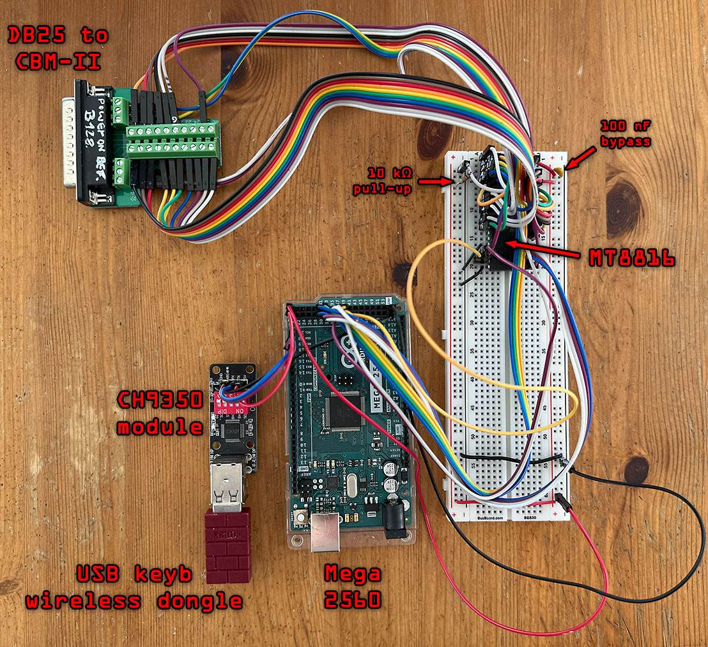

# CBM-II (B128/B256) USB Keyboard Adapter

Connect a USB keyboard to your CBM-II.  
**NOTE: This is for High-Profile machines (separate keyboard).**  However, it can be adapted for Low-Profile machines.  
The current prototype is using a breadboard. PCB is work in progress.  


*The current prototype*

## Ingredients

| **Quantity** | **Item** | **Notes** |
|---:|---|---|
| 1 | DB25 male connector | I used the screw-terminal type for this prototype.¹ |
| 1 | Arduino Mega 2560 | Tested on Mega 2560 R3. |
| 1 | CH9350L | USB to serial module. I use the _Mustpoint Ch9350_. |
| 1 | MT8816 | I used the "AE1" version (40 pin DIP) for the prototype. |
| 1 | 100 nF ceramic capacitor, 16 V | Bypass capacitor |
| 1 | 10 kΩ resistor | Pull-up for RESET |
| 1 | Breadboard | For prototyping. PCB design is not yet ready. |
| (see below) | Wires | |
| 1 | USB Keyboard | Use your favorite PC keyboard. I have a wireless one with USB dongle. |

¹ You may prefer a solder-cup 25DB male connector. The screw-terminal is only useful for prototyping. The final PCB design (work in progress) will just need a 25DB-to-25DB full cable (all pins wired).  

## Wiring

Schematics are in the [KiCad](https://github.com/0x444454/cbm2/tree/main/usbka/KiCad) project.  

### Arduino Mega to MT8816 control and power

Use the Mega +5V and GND for power and ground.  

| Mega | MT8816AE1 pin | Signal / notes |
|---|---:|---|
| D30 | 5 | AX0 |
| D31 | 22 | AX1 |
| D32 | 23 | AX2 |
| D33 | 4 | AX3 |
| D34 | 24 | AY0 |
| D35 | 25 | AY1 |
| D36 | 2 | AY2 |
| D37 | 38 | DATA |
| D38 | 18 | STROBE² |
| D39 | 3 | RESET: Add the **10 kΩ pull-up** resistor to +5V |
| D40 | 19 | Y5: shared with DB25 pin 13 (PC5); USBKA leaves D40 as an input with no internal pull-up |
| +5V | 36, 40 | CS, VDD³ |
| GND | 16, 20 | VSS, VEE |

² No STROBE pull-down is fitted in this build (optional).  
³ Fit a **100 nF ceramic bypass capacitor** between MT8816 pin 40 (VDD) and GND, close to the chip.  

Leave MT8816 pins 14 (N/C), 15 (Y7), 17 (Y6), and 34 (N/C) unconnected.  

### CBM-II DB25 male to MT8816 matrix

| DB25 pin | CBM-II signal | MT8816 signal | MT8816AE1 pin |
|---:|---|---|---:|
| 1 | PA0 | X8 | 10 |
| 2 | PA2 | X10 | 12 |
| 3 | PA4 | X12 | 27 |
| 4 | PA6 | X14 | 6 |
| 5 | PB0 | X0 | 33 |
| 6 | PB1 | X1 | 32 |
| 7 | PB2 | X2 | 31 |
| 8 | PB3 | X3 | 30 |
| 9 | PB4 | X4 | 29 |
| 10 | PB5 | X5 | 28 |
| 11 | PB6 | X6 | 8 |
| 12 | PB7 | X7 | 9 |
| 13 | PC5 | Y5, also Mega D40 | 19 |
| 14 | PA1 | X9 | 11 |
| 15 | PA3 | X11 | 13 |
| 16 | PA5 | X13 | 26 |
| 17 | PA7 | X15 | 7 |
| 18 | PC0 | Y0 | 35 |
| 19 | PC1 | Y1 | 37 |
| 20 | PC2 | Y2 | 39 |
| 21 | PC3 | Y3 | 1 |
| 22 | GND | Common ground | — |
| 23, 24 | N/C | — | — |
| 25 | PC4 | Y4 | 21 |

Leave DB25 pins 23 and 24 unconnected.  

### Mega to CH9350L module

| Mega | CH9350L module |
|---|---|
| D18 "TX1" | RX |
| D19 "RX1" | TX |
| +5V | 5V (input) |
| GND | GND |

If your CH9350L module has a "485" pin, leave it unconnected.  
If your module (e.g. _Mustpoint Ch9350_) has 5 dip switches, set all of them to the "1" position (printed on the PCB). This will set it to **USB host**, **States 0/1**, serial interface at **115200 baud**.  

### CH9350L module to USB keyboard

Connect your USB keyboard to the module’s USB-A socket.  

## Double check connections

**Make sure your system is powered off when connecting the adapter.**  

Double check all wirings.
Keep both computer and USBKA (Arduino Mega) powered off.  
Plug the PSU connector into the motherboard.  
Get your meter and set it to verify continuity.  
Make sure no voltage line is shorted to ground.  

## Debugging

The Mega sends debug output to its USB interface at 500k baud. Check the Serial Monitor window on the Arduino IDE.  

In the INO sketch, you can configure debug verbosity:

```
// Debug logging controls only.
int debug_log_raw = 0;     // 0..1: CH9350L status, key frames and valid report byte changes
int debug_log_hid = 0;     // 0..1: decoded HID transitions and unsupported report notices
int debug_log_us_iso = 2;  // 0=disabled, 1=press, 2=press and release
int debug_log_conv = 1;    // 0=disabled, 1=converted B128/B256 key presses, 2=also print CBM-II port bits and physical MT8816 X/Y lines
```

## Power on sequence

After you have double checked everything and made sure there are no shorts, you can proceed with power on.  
**Always power on the USBKA (Arduino Mega) first. Then the computer.**  

## Power off sequence

**Always power off the computer first. Then the USBKA (Arduino Mega).**  


## Troubleshooting

Check wirings again.  
If only some keys are not working, then you may have a partially failed MT8816 chip. If buying used, get more than one chip, just in case.  

## References

CBM-II [High-Profile keyboard schematics](https://www.zimmers.net/anonftp/pub/cbm/schematics/computers/b/8256059-10.gif).  
MT8816: [MT8816 datasheet, Figure 2 (40-pin DIP)](https://www.mouser.com/datasheet/2/268/Microchip_06182024_MT8816AE1-3459976.pdf#page=2).  
Arduino Mega 2560 Rev3 [pinout](https://docs.arduino.cc/resources/pinouts/A000067-full-pinout.pdf).  


# LICENSE

Creative Commons, CC BY

https://creativecommons.org/licenses/by/4.0/deed.en

Please add a link to this github project.
